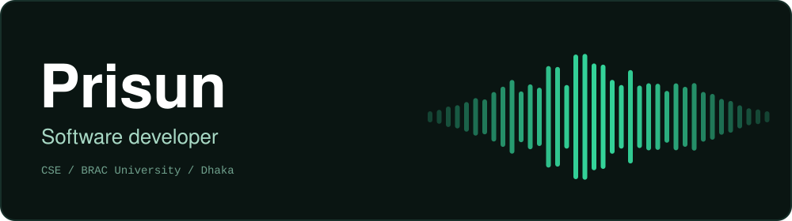

<picture>
  <source media="(prefers-color-scheme: dark)" srcset="banner-dark.svg">
  <source media="(prefers-color-scheme: light)" srcset="banner-light.svg">
  
</picture>

Software developer and final year Computer Science and Engineering student at BRAC University, Dhaka.
I work mostly in Java and the JavaScript ecosystem, from database design to React interfaces.
I'm interested in software engineering and in how AI and ML are applied in production systems.

## Stack

| Layer | Tools |
|---|---|
| Languages |   |
| Frontend |  |
| Backend |  |
| Data |  |
| Tools |  |

## Selected work

### [Reverb](https://github.com/PrisunSaif/Reverb)
A full-stack music streaming platform, built with a team of three as a course project.
Collaborative and nested playlists, radio stations, a song queue with an incognito mode, and listening history.
Runs locally with demo data.

`React` `Node.js` `Express` `MySQL`

## Currently

- Final year at BRAC University
- Working on a software engineering team project and my thesis
- Open to software engineering opportunities after graduation

## Contact

[LinkedIn](https://www.linkedin.com/in/mahdinam-saif-prisun) | [Email](mailto:m.saif.prisun@gmail.com)
